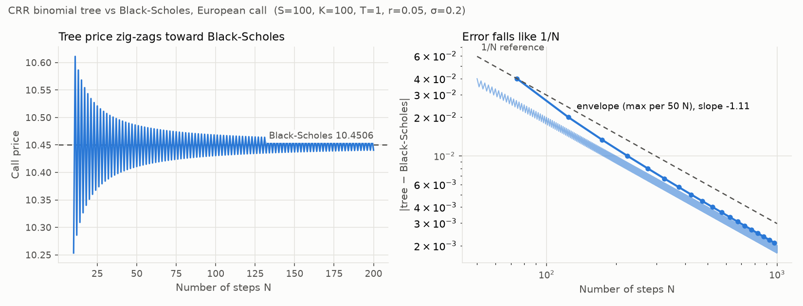

# optionlab

A Python library for pricing European and American options with several models,
computing the Greeks, and finding implied volatility. Built as a learning project in
derivatives pricing.

## Roadmap

- [x] Phase 1: Black-Scholes closed-form pricing (European call/put, dividend yield `q`)
- [x] Phase 2: Greeks, analytic and numerical (bumping)
- [x] Phase 3: Binomial tree (Cox-Ross-Rubinstein), including American options
- [x] Phase 4: Monte Carlo pricing with standard error and antithetic variates
- [x] Phase 5: Implied volatility solver (Newton-Raphson with bisection fallback)
- [ ] Phase 6: Streamlit demo page with plots

## Quick example

```python
from optionlab import bs_price, crr_price, delta, vega, theta

bs_price(S=100, K=100, T=1, r=0.05, sigma=0.2, option="call")  # 10.4506...
delta(S=100, K=100, T=1, r=0.05, sigma=0.2, option="call")     # 0.6368...
vega(S=100, K=100, T=1, r=0.05, sigma=0.2)                     # 37.52 per 1.00 of sigma
theta(S=100, K=100, T=1, r=0.05, sigma=0.2, option="call")     # -6.414 per year

# Binomial tree (Cox-Ross-Rubinstein), European or American exercise
crr_price(S=100, K=100, T=1, r=0.05, sigma=0.2, option="put", steps=500, exercise="american")  # 6.09
```

Monte Carlo returns the price with its standard error. It is random, so pass `seed=` to make
a run repeatable. Antithetic variates give a smaller error for the same number of paths.
(This block is run by `tests/test_readme.py`, so the numbers can't drift from the code.)

```python
>>> from optionlab import mc_price
>>> mc_price(S=100, K=100, T=1, r=0.05, sigma=0.2, paths=100_000, seed=42)
MCResult(price=10.4205..., std_error=0.0467..., paths=100000)
>>> mc_price(S=100, K=100, T=1, r=0.05, sigma=0.2, paths=100_000, seed=42, antithetic=True)
MCResult(price=10.4673..., std_error=0.0330..., paths=100000)
```

Both are within one standard error of the Black-Scholes price, 10.4506. The true price lies
in `price ± 1.96 * std_error` about 95% of the time.

Implied volatility runs Black-Scholes backwards: given a price, it finds the σ that
produces it (Newton's method inside a bracket, with bisection as the fallback).

```python
>>> from optionlab import implied_vol
>>> implied_vol(1.875, S=21, K=20, T=0.25, r=0.1)  # Hull's example: 23.5%
0.2345129...
>>> implied_vol(10.4506, S=100, K=100, T=1, r=0.05)  # the rounded price above: back to 20%
0.200000...
```

Conventions: `T` in years; `r`, `sigma`, `q` annualised decimals (0.05 = 5%);
`option` is `"call"` or `"put"`. `bs_price` and the Greeks accept scalars and numpy arrays;
`crr_price` and `mc_price` take scalars only.
Greeks: vega and rho are per **1.00** change (divide by 100 for per 1%);
theta is `-dP/dT` **per year** (divide by 365 for per day).

## Install and test

```bash
python -m venv .venv
.venv\Scripts\activate          # Windows; on macOS/Linux: source .venv/bin/activate
pip install -e ".[dev]"            # add ",validation" for the QuantLib cross-check
pytest
```

The convergence plot is regenerated with `pip install -e ".[plots]"` and
`python scripts/plot_convergence.py`.

## Interactive demo

A Streamlit page to play with the pricers in the browser: set S, K, T, r, σ, q and the
number of tree steps, and compare Black-Scholes with the European and American tree.
It is written for non-experts too: a glossary, plain-English sentences that update with the
inputs ("if the stock rises $1, the option's price goes up by about $0.64"), and the technical
details (tree steps, analytic vs numerical Greeks) under "Show the maths".

```bash
pip install -e ".[app]"
streamlit run app/streamlit_app.py
```

## Binomial tree convergence

The CRR tree converges to the Black-Scholes price, zig-zagging between odd and even
step counts, with an error that falls like 1/N:

<picture>
  <source media="(prefers-color-scheme: dark)" srcset="docs/convergence-dark.png">
  
</picture>

## Docs

- [Black-Scholes notes](docs/black_scholes_notes.md): intuition behind d1, d2 and risk-neutral pricing
- [Greeks notes](docs/greeks_notes.md): intuition, scaling conventions, and how the formulas are verified
- [Binomial tree notes](docs/binomial_notes.md): u, d, p, backward induction, American exercise and convergence
- [Monte Carlo notes](docs/monte_carlo_notes.md): exact sampling, why the error falls like 1/√N, antithetic variates, and how the standard error is tested
- [Implied volatility notes](docs/implied_vol_notes.md): why there is exactly one answer, Newton vs bisection, the two fixes random testing forced, and where the price stops determining σ

## Known limitations

- Black-Scholes assumes constant volatility and constant interest rates (no smile or term structure).
- Black-Scholes prices European exercise only; use `crr_price(..., exercise="american")` for American options.
- Dividends are a continuous yield, not discrete cash dividends.
- Prices are lognormal: no jumps, no transaction costs, no borrowing constraints.
- `S` and `K` must be strictly positive.
- Greeks are undefined at `T == 0` or `sigma == 0` and raise `ValueError` (for an array input,
  if any element is degenerate). Prices still work there.
- `crr_price` accepts scalar inputs only (wrap it in `np.vectorize` to price many options),
  needs `sigma > 0`, and raises `ValueError` if a step is too long for the risk-neutral
  probability to lie in (0, 1); use more steps.
- The tree's error shrinks like 1/N but zig-zags between odd and even N: at the default
  N = 500 the at-the-money call above is off by about 0.004 (2 correct decimals).
  10x more steps gives about 10x less error, at 10x the cost.
- `mc_price` prices European options only and takes scalar inputs. Its result is random unless
  `seed` is set. The error shrinks like 1/√paths: 10x less error costs 100x more paths.
- The Monte Carlo standard error is unreliable when fewer than about 1% of paths finish in
  the money (deep out of the money), and it can even be 0 while the true price is > 0.
- For σ√T above about 2 (e.g. 200% volatility over one year), a few rare, huge paths carry
  most of the price. A typical Monte Carlo run then gives a price that is too low and a
  standard error that is too small. See the [Monte Carlo notes](docs/monte_carlo_notes.md).
- `implied_vol` inverts the *European* Black-Scholes formula and takes scalar inputs. For
  American options (most listed US stock options) it is exact for calls on non-dividend
  stocks only; elsewhere the early-exercise premium makes the implied volatility too high.
  Example: the American put above (S = K = 100, T = 1, σ = 20%) is worth 6.09, and inverting
  that with the European formula gives 21.4%.
- `implied_vol` raises `ValueError` for prices outside the no-arbitrage bounds, exactly on
  the lower bound (σ would be 0), and at `T == 0`, where no volatility fits.
- Deep in the money, the price is almost all intrinsic value and barely moves with σ:
  rounding the price moves σ by about 2.2e-16 · price / vega. For a 1-year call with K = 100
  at S = 400, the next float up moves σ from 0.20007 to 0.20014. With real 2-decimal quotes
  it is far worse: one cent is 9 vol points for a 3-month call at S = 150, K = 100. See the
  [implied volatility notes](docs/implied_vol_notes.md).
- Below about 1e-300, at the bottom of the float range, `bs_price` itself loses accuracy
  (the two terms of the formula underflow and cancel), so prices and implied volatilities
  there are unreliable. Down to 7e-298 it is accurate to about 2.5e-11 relative.
